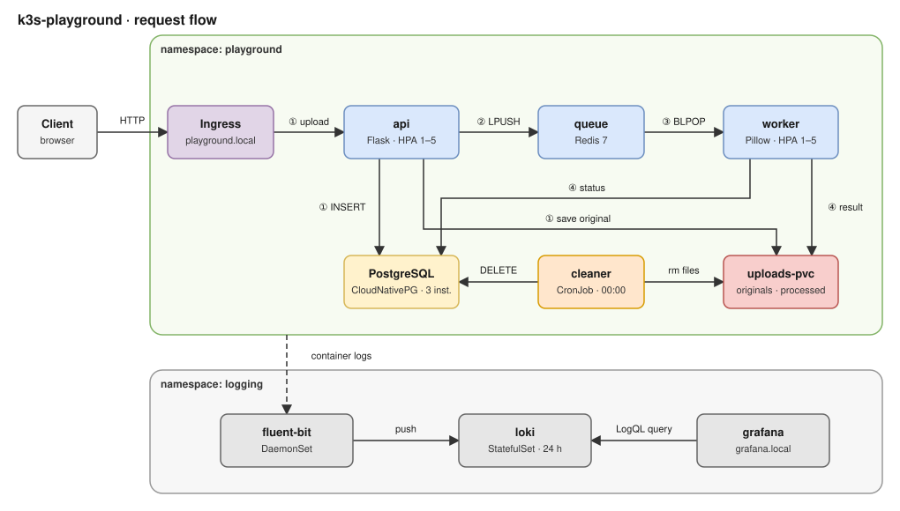
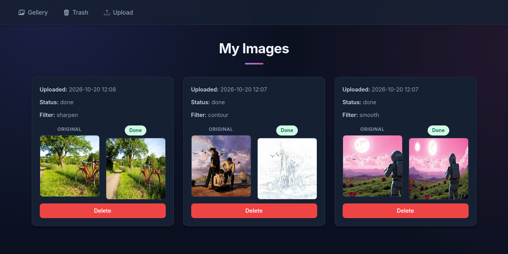
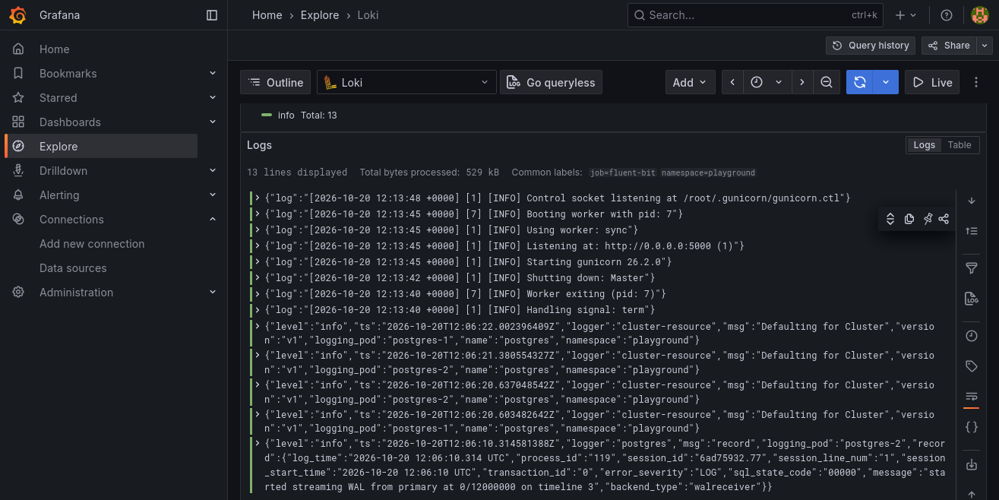

# k3s-playground

Asynchronous image-processing pipeline (upload → resize/filter → storage) used as a hands-on project to practise Kubernetes on k3s.

It exercises: Deployment, StatefulSet, Job, CronJob, DaemonSet, ConfigMap, Secret, PVC, Ingress, NetworkPolicy, RBAC, HPA, and an operator-managed resource (CloudNativePG `Cluster`) for a highly available PostgreSQL. Images are tested, built and pushed by GitHub Actions. Container logs go through Fluent Bit → Loki → Grafana.

## Contents

- [Architecture](#architecture)
- [API](#api)
- [Repository layout](#repository-layout)
- [Kubernetes resources](#kubernetes-resources)
- [Network policies](#network-policies)
- [Prerequisites](#prerequisites)
- [Local development](#local-development)
- [Tests](#tests)
- [CI/CD](#cicd)
- [Deployment](#deployment)
- [Access](#access)
- [Operations](#operations)
- [Configuration](#configuration)
- [Known limitations](#known-limitations)

## Architecture



| Component | Kind | Role |
|---|---|---|
| `api` | Deployment | Flask app: web UI (upload, gallery, trash) and HTTP API. Writes the original file, inserts a task row, pushes a message on the queue. |
| `queue` | Deployment | Redis 7. The API `LPUSH`es to `image_tasks`; workers `BLPOP`. |
| `worker` | Deployment | Pops a task, resizes the image, applies the filter (Pillow), writes the result to `processed/`, sets the task status to `done` or `failed`. |
| `postgres` | CNPG `Cluster` | 1 primary + 2 replicas, managed by the CloudNativePG operator. Stores task metadata and status. |
| `old-task-deleting` | CronJob | Daily at 00:00: deletes tasks that have been in the trash for more than `CLEANING_AFTER` days, together with their files. |
| `db-init` | Job | Creates the schema (`db.create_all()`). |
| `fluent-bit` | DaemonSet | Tails `/var/log/containers/*.log`, adds Kubernetes metadata, ships to Loki. |
| `loki`, `grafana` | StatefulSet, Deployment | Log storage and UI (`logging` namespace). |

Task lifecycle: `pending` → `done` | `failed`. Deletion is a soft delete (`deleted`, `deleted_at`); restoring clears both. The cleaner performs the hard delete.

Storage: a single PVC (`uploads-pvc`) is mounted with `subPath: originals` and `subPath: processed`. The mount point differs per component:

| Component | `originals` | `processed` |
|---|---|---|
| api | `/api/uploads/originals` | `/api/uploads/processed` |
| worker | `/worker/uploads/originals` | `/worker/uploads/processed` |
| cleaner | `/uploads/originals` | `/uploads/processed` |

Files are stored as `<uuid><extension>` in both directories.

## Screenshots

<p>
  
  
</p>

*Left: the gallery with original and processed images. Right: API logs in Grafana, collected by Fluent Bit and stored in Loki.*

## API

| Method | Path | Description |
|---|---|---|
| GET, POST | `/upload` | GET: upload form. POST (multipart): `image`, `filter`, `width`, `height` → `202 {"image_id": "<uuid>"}` |
| GET | `/status/<image_id>` | `{"status": "pending" \| "done" \| "failed"}`, `404` if unknown |
| GET | `/`, `/gallery` | Gallery (non-deleted tasks, newest first) |
| GET | `/trash` | Soft-deleted tasks |
| DELETE | `/images/<id>` | Move to trash. `404` unknown, `409` already deleted |
| POST | `/images/<id>/restore` | Restore from trash. `404` unknown, `409` not deleted |
| GET | `/files/originals/<file>`, `/files/processed/<file>` | Serve stored files |
| GET | `/health/live` | Liveness (always `200` while the process runs) |
| GET | `/health/ready` | Readiness: `200` only if PostgreSQL and Redis both answer, else `503` |

Upload validation (`400` on failure): `image` present; extension in `.png .jpg .jpeg .webp`; `filter` in the allow-list; `width` and `height` integers in `[1, 4000]`.

Filters (Pillow `ImageFilter`, applied after the resize): `blur`, `sharpen`, `edges`, `smooth`, `smooth_more`, `contour`, `emboss`, `detail`, `edge_enhance`, `edge_enhance_more`, `gaussian_blur`, `unsharp_mask`, `min_filter`, `max_filter`, `mode_filter`.

## Repository layout

```
.
├── .github/workflows/        # one workflow per image: ci-api, ci-worker, ci-cleaner
├── api/                      # Flask API
│   ├── tests/                # pytest integration tests
│   ├── compose.tests.yaml    # throw-away stack used by the tests
│   └── db_init.py            # creates the schema
├── worker/                   # image-processing worker
├── cleaning/                 # script run by the CronJob
├── docs/                     # architecture diagram and screenshots
├── manifests/                # Kubernetes manifests
│   ├── hpa/                  # HorizontalPodAutoscalers (api, worker)
│   ├── jobs/                 # db-init Job
│   ├── logging/              # Fluent Bit, Loki, Grafana, RBAC
│   └── secrets-example/      # Secret templates (no real values)
├── docker-compose.yaml       # local stack without Kubernetes
├── .env.example              # variables for the local Compose stack
└── secrets-local/            # real Secret manifests, git-ignored (create it yourself)
```

## Kubernetes resources

| Path | Contents |
|---|---|
| `playground-ns.yaml` | Namespace `playground` + `default-deny-ingress` NetworkPolicy |
| `config.yaml` | ConfigMap `config` |
| `secrets-example/*.example.yaml`, `secrets-example/grafana-secret.example.yaml` | Secret templates: `postgres-secret`, `secret-config`, `gf-secret` |
| `uploads-pvc.yaml` | PVC `uploads-pvc` (100Mi, RWO) |
| `postgres.yaml` | CNPG `Cluster` `postgres` (3 instances, 100Mi each) + NetworkPolicy |
| `queue.yaml` | Redis Deployment, Service `queue-svc`, NetworkPolicy |
| `api.yaml` | Deployment (liveness/readiness probes, resource limits), Service `api-svc`, NetworkPolicy |
| `worker.yaml` | Deployment |
| `ingress.yaml` | Ingress `playground.local` → `api-svc:80` |
| `jobs/db-init-job.yaml` | Job `db-init` running `python db_init.py` (`backoffLimit: 4`) |
| `old-task-deleting.yaml` | CronJob `0 0 * * *`, pod label `app: cleaner` |
| `hpa/` | HPAs for `api` and `worker`: 1–5 replicas, 70 % CPU target |
| `logging/rbac-fluent.yaml` | Namespace `logging`, ServiceAccount `fluent-bit`, ClusterRole, ClusterRoleBinding |
| `logging/fluent-bit-*.yaml` | Fluent Bit ConfigMap and DaemonSet |
| `logging/loki.yaml` | Loki ConfigMap, Service, StatefulSet (500Mi PVC, 24 h retention) |
| `logging/grafana.yaml` | Grafana Deployment, Service, provisioned Loki datasource, Ingress `grafana.local` |

All application images are `elbergui/playground-{api,worker,cleaner}:latest` with `imagePullPolicy: Always`.

## Network policies

Ingress to the `playground` namespace is denied by default. Each component opens only what it needs:

| Policy | Target | Allowed sources |
|---|---|---|
| `default-deny-ingress` | all pods | none |
| `api-network-policy` | `app=api` | namespace `kube-system` (Traefik) |
| `queue-network-policy` | `app=queue` | `app=api`, `app=worker` |
| `postgres-network-policy` | `cnpg.io/cluster=postgres` | `app=api`, `app=worker`, `app=db-init`, `app=cleaner`, the cluster's own instances (replication), namespace `cnpg-system` (operator) |

The worker accepts no inbound traffic, so it has no allow rule. The `logging` namespace has no NetworkPolicy.

> Any new pod that must reach PostgreSQL needs its label added to `postgres-network-policy`.

## Prerequisites

- k3s (single node is enough) with a CNI that enforces NetworkPolicies (default k3s setup does)
- `kubectl` pointed at the cluster
- [CloudNativePG operator](https://cloudnative-pg.io/documentation/current/installation_upgrade/) installed (creates `cnpg-system`)
- metrics-server for the HPAs (bundled with k3s)
- Images on Docker Hub (built by the workflows, or build `api/`, `worker/`, `cleaning/` yourself and change the `image:` fields)
- `/etc/hosts` entries for the Ingress hosts (see [Access](#access))

## Local development

Docker Compose runs the API, worker, cleaner, PostgreSQL and Redis without Kubernetes.

```bash
cp .env.example .env     # fill in POSTGRES_DB, POSTGRES_USER, POSTGRES_PASSWORD
```

`docker-compose.yaml` uses two bind-mounted named volumes (`db-data`, `uploads`). Their `device:` paths are hard-coded (`/home/mohamed/...`); change them and create the directories first:

```bash
mkdir -p <db-dir> <uploads-dir>/originals <uploads-dir>/processed
```

Start the stack and create the schema (Compose does not run the init job):

```bash
docker compose up --build -d
docker compose exec api python db_init.py
```

The app listens on <http://localhost:5000>. The `clean` service runs once at startup and exits.

## Tests

`api/tests/test_routes.py` holds integration tests that call a running API backed by real PostgreSQL and Redis: health probes, upload validation, status, file serving, delete/restore, HTML pages.

```bash
cd api
# api/.env: POSTGRES_HOST=db-test, REDIS_HOST=redis-test, plus the other keys from .env.example
docker compose -f compose.tests.yaml up -d --build
docker compose -f compose.tests.yaml exec -T api-test \
  sh -c "python db_init.py && pip install pytest requests && pytest -v"
docker compose -f compose.tests.yaml down -v
```

`compose.tests.yaml` bind-mounts directories under `/home/runner/mohamed/playground-volum/` (the layout of a GitHub-hosted runner): `test-db` and `test-upload/{originals,processed}`. Create them, or change the paths, to run the stack elsewhere.

The compose stack starts with an empty database, so `python db_init.py` must create the `tasks` table before `pytest` runs. The `tests/` directory must stay in the image: the tests run inside the `api-test` container.

## CI/CD

One workflow per image. Each runs on a push to `main` that touches the corresponding directory.

| Workflow | Path filter | Jobs |
|---|---|---|
| `ci-api.yaml` | `api/**` | `tests` (compose stack, `db_init.py`, pytest) → `build-and-push` (only if `tests` passes) |
| `ci-worker.yaml` | `worker/**` | build and push |
| `ci-cleaner.yaml` | `cleaning/**` | build and push |

Images are pushed as `elbergui/playground-<name>:<commit-sha>` and `:latest`.

Repository settings required (Settings → Secrets and variables → Actions):

| Type | Name | Used by |
|---|---|---|
| Variable | `DOCKERHUB_USERNAME` | all |
| Secret | `DOCKERHUB_TOKEN` | all |
| Variables | `TEST_POSTGRES_HOST`, `TEST_POSTGRES_PORT`, `TEST_POSTGRES_DB`, `TEST_REDIS_HOST`, `TEST_REDIS_PORT` | API tests |
| Secrets | `TEST_POSTGRES_USER`, `TEST_POSTGRES_PASSWORD` | API tests |

`TEST_POSTGRES_HOST` / `TEST_REDIS_HOST` must be the compose service names (`db-test`, `redis-test`).

## Deployment

Run all commands from the repository root.

### 1. Namespace and default-deny policy

```bash
kubectl apply -f manifests/playground-ns.yaml
```

### 2. ConfigMap

```bash
kubectl apply -f manifests/config.yaml
```

### 3. Secrets

Real Secret manifests live in `secrets-local/`, which is listed in `.gitignore`. Never put filled-in files in `manifests/secrets-example/`, which only holds the templates.

```bash
mkdir -p "secrets-local"
cp manifests/secrets-example/postgres-secret.example.yaml "secrets-local/postgres-secret.yaml"
cp manifests/secrets-example/secret-config.example.yaml   "secrets-local/secret-config.yaml"
# replace CHANGE_ME in both files, then:
kubectl apply -f "secrets-local/postgres-secret.yaml"
kubectl apply -f "secrets-local/secret-config.yaml"
```

Constraint: `postgres-secret` bootstraps the database through CloudNativePG. Its `username` must equal the `owner` in `postgres.yaml` (`admin`), and `secret-config` (`POSTGRES_USER`, `POSTGRES_PASSWORD`) must carry the same credentials, since the application uses it to connect.

### 4. Storage, database, queue

```bash
kubectl apply -f manifests/uploads-pvc.yaml
kubectl apply -f manifests/postgres.yaml
kubectl apply -f manifests/queue.yaml

# wait for PostgreSQL before running the init job
kubectl wait --for=condition=Ready cluster/postgres -n playground --timeout=300s
```

### 5. Schema initialisation

```bash
kubectl apply -f manifests/jobs/db-init-job.yaml
kubectl wait --for=condition=complete job/db-init -n playground --timeout=120s
```

### 6. Application

```bash
kubectl apply -f manifests/api.yaml
kubectl apply -f manifests/worker.yaml
kubectl apply -n playground -f manifests/ingress.yaml
```

### 7. Autoscaling and cleanup

```bash
kubectl apply -f manifests/hpa/
kubectl apply -f manifests/old-task-deleting.yaml
```

### 8. Logging

`rbac-fluent.yaml` creates the `logging` namespace, so it goes first.

```bash
kubectl apply -f manifests/logging/rbac-fluent.yaml

# Grafana admin credentials
cp manifests/secrets-example/grafana-secret.example.yaml "secrets-local/grafana-secret.yaml"
# replace CHANGE_ME, then:
kubectl apply -f "secrets-local/grafana-secret.yaml"

kubectl apply -f manifests/logging/loki.yaml
kubectl apply -f manifests/logging/grafana.yaml
kubectl apply -f manifests/logging/fluent-bit-config.yaml
kubectl apply -f manifests/logging/fluent-bit-daemonset.yaml
```

## Access

Add the Ingress hosts to `/etc/hosts` with the IP of the k3s node:

```
<node-ip>  playground.local grafana.local
```

- <http://playground.local>: application
- <http://grafana.local>: Grafana (credentials from `gf-secret`). The Loki datasource is provisioned. In Explore, `{namespace="playground", container="api-flask"}` shows the API logs. Labels available: `namespace`, `pod`, `container`, `job`.

## Operations

Status checks:

```bash
kubectl get all -n playground
kubectl get cluster -n playground                     # expect "Cluster in healthy state"
kubectl get pvc,ingress,hpa,networkpolicy -n playground
kubectl get cronjob,job -n playground
kubectl get daemonset,statefulset,deployment,ingress -n logging
kubectl logs -n logging ds/fluent-bit                 # shipping errors to Loki appear here
```

Deploy a new image. Manifests reference `:latest` with `imagePullPolicy: Always`, so a pod picks up a new build only when it is recreated:

```bash
kubectl rollout restart deployment/api deployment/worker -n playground
```

The CronJob pulls the image on every run. To re-run schema initialisation: `kubectl delete job db-init -n playground`, then re-apply the manifest.

Run the cleaner on demand and read its output:

```bash
kubectl create job --from=cronjob/old-task-deleting cleaner-manual -n playground
kubectl logs -n playground job/cleaner-manual
```

## Configuration

ConfigMap `config` (`manifests/config.yaml`) is injected into the API, worker, `db-init` Job and cleaner. Credentials come from `secret-config`.

| Key | Value | Description |
|---|---|---|
| `POSTGRES_HOST` | `postgres-rw` | CNPG read/write Service, always the primary |
| `POSTGRES_PORT` | `5432` | |
| `POSTGRES_DB` | `k3s-playground-db` | Created by the operator at bootstrap |
| `REDIS_HOST`, `REDIS_PORT` | `queue-svc`, `6379` | Redis queue |
| `CLEANING_AFTER` | `0` | Days a task stays in the trash before the cleaner deletes it (`deleted_at <= now() - N days`). `0` deletes everything in the trash at each run. |

CNPG also exposes `postgres-ro` (replicas only) and `postgres-r` (any instance).

## Known limitations

- `db-init` fails and retries (up to 4 times) if it starts before PostgreSQL is ready; the `kubectl wait` in step 4 avoids this.
